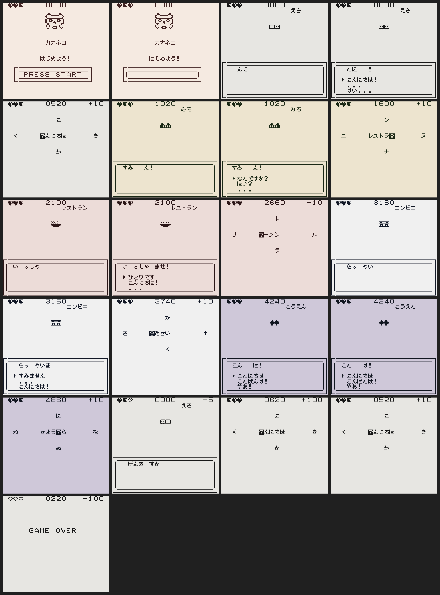

# 🐱 Kananeko

> A tiny Game Boy Color ROM where a cat guides you through Japan — one kana at a time.

You wander through five little locations — a train station, a street, a restaurant, a convenience store, and a park — chatting your way through short Japanese scenes and answering kana quizzes to keep going. Miss too many and it's game over. Nail them and watch your score climb.

The whole thing is hand-assembled from TypeScript. No engine, no SDK — just raw opcodes wired into a 32 KB ROM.

## 🗾 Locations

| Scene      | Name              | Vibe                   |
| ---------- | ----------------- | ---------------------- |
| えき       | Station           | Arriving somewhere new |
| みち       | Street            | Wandering around town  |
| レストラン | Restaurant        | Ordering food (poorly) |
| コンビニ   | Convenience store | Late-night snack run   |
| こうえん   | Park              | A quiet ending         |

## 🎮 How it works

1. Title screen → pick a scene
2. Read through a short dialogue (in Japanese!)
3. Answer kana quiz questions
4. Keep your lives — gain your score
5. Advance to the next location

## 🖼️ Screenshots



See [the gallery](docs/screenshots/README.md); regenerate it with `npm run screenshots`.

## 🔧 Setup

Needs **Node.js 25+** — older versions (e.g. 18) won't work with the current toolchain.

```bash
npm install
npm run build
```

Out comes `build/kananeko.gb` — load it in any Game Boy emulator and go.

A symbol file (`build/kananeko.sym`, BGB/no$gmb format) is also produced for debugging.

## 🧪 Tests

```bash
npm test                   # run all tests
npm run test:coverage      # with coverage
npm run check              # typecheck + lint + format check + tests (what CI runs)
```

- `test/asm/` — opcode encodings, assembler validation, and macros (run in the emulator)
- `test/content.test.ts` — static checks over every scene: dialogue graph, text widths, kana questions, ROM encoding round-trips
- `test/play/` and `test/scenes/` — the real ROM driven by joypad input in [serverboy](https://gitlab.com/piglet-plays/serverboy.js), a headless Game Boy emulator

Emulator tests start from checkpoints (the start of each scene and kana round) recorded from one continuous playthrough. Checkpoints are cached in `node_modules/.cache/kananeko/`, keyed by the ROM and the test driver source, so only the first run after a change pays for the playthrough.

Each scene's test file lists the dialogue paths worth exercising as detours from the good path:

```ts
describeScene(0, [
  { name: 'tired clerk', detours: { 1: 2 } }, // at node 1, pick choice 2
]);
```

## 📁 Project layout

```
src/
  asm/           assembler, opcodes, macros, hardware defs
  game/          engines (dialogue, kana, HUD), fonts, screen helpers
    scenes/      station, street, restaurant, conbini, park
  build.ts       ROM entry point
test/            unit, integration, and emulator-driven tests
scripts/         utility scripts
build/           ROM output
```

## 🤓 Nerd notes

- The ROM is assembled entirely from TypeScript — a custom assembler in `src/asm` emits raw Game Boy machine code.
- Hiragana, katakana, and latin glyphs are all baked into the ROM as tile data.
- Gameplay tests boot the actual ROM in a headless emulator and drive it with simulated joypad input.
- The final ROM is exactly 32 KB — one bank, no mapper.
