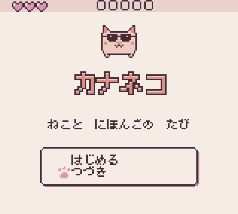
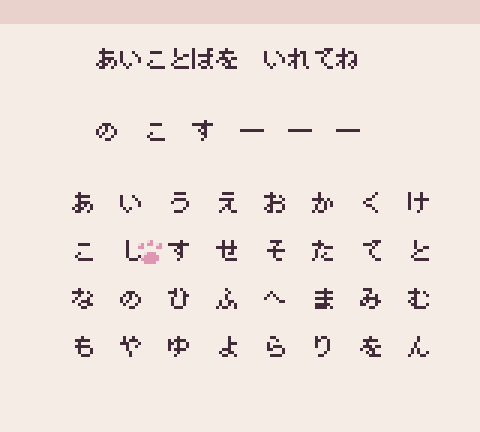
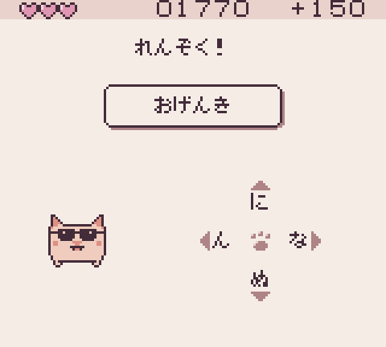
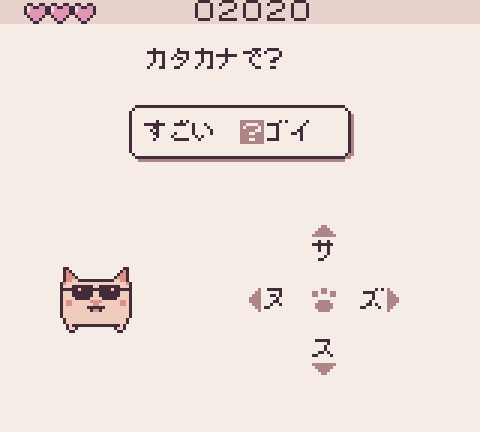
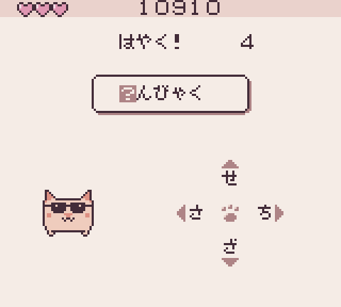

# Screenshots

Captured from the real ROM in the test emulator by `npm run screenshots`.

|                                                                              |                                                                              |                                                                  |
| ---------------------------------------------------------------------------- | ---------------------------------------------------------------------------- | ---------------------------------------------------------------- |
|                                                    |                          |                   |
| Title screen                                                                 | Title menu: continue (つづき)                                                | Typing a password (あいことば)                                   |
|                                     |                                          |                              |
| えき: text revealing                                                         | えき: choices                                                                | えき: kana round                                                 |
|                                     |                                          |                              |
| みち: text revealing                                                         | みち: choices                                                                | みち: kana round                                                 |
|                               |                                    |                        |
| レストラン: text revealing                                                   | レストラン: choices                                                          | レストラン: kana round                                           |
|                                 |                                      |                          |
| コンビニ: text revealing                                                     | コンビニ: choices                                                            | コンビニ: kana round                                             |
|                                 |                                      |                          |
| こうえん: text revealing                                                     | こうえん: choices                                                            | こうえん: kana round                                             |
|           |                            |  |
| After a bad choice: -5 and a lost heart                                      | Kana: correct answer feedback                                                | Kana: three first tries in a row pay a bonus                     |
|  |  |                    |
| Kana: the review ends with a word to write in katakana                       | Speed round: one more from each scene, against the clock                     | Kana: wrong answer feedback                                      |
|                                    |                                                   |
| Ending: every scene cleared                                                  | Game over                                                                    |
